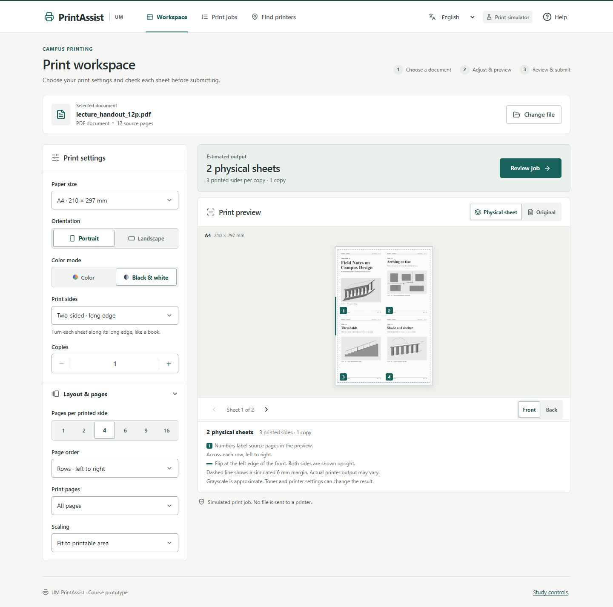

# UM PrintAssist

**[Open the live prototype](https://elsayx.github.io/um-printassist/)** in your browser. No installation or sign-in required.

A mobile-first campus printing simulator for CISC2007 Group B. Students can lay out a real document, inspect both faces of each physical sheet and check whether a simulated service received their job. No campus login, printer, payment or server-side file upload is involved.



## Run the prototype

With Docker and Docker Compose installed and running:

```sh
git clone https://github.com/Elsayx/um-printassist.git
cd um-printassist
docker compose up -d --build
```

Open **http://localhost:8080** on the host computer. The initial build needs internet access. Once built, the app, PDF worker, fonts and sample documents run on the local network. The printer map also runs locally. Optional source, attribution and help links open external sites. To stop the app, run `docker compose down`.

**Connect a phone or another laptop.** On Windows run `ipconfig` and find the active Wi-Fi adapter's IPv4 address. On macOS look under System Settings → Wi-Fi → Details → TCP/IP. On Linux run `hostname -I` and choose the LAN address. On the other device, join the same Wi-Fi and open `http://HOST-LAN-IP:8080`, replacing the placeholder with the address. Allow inbound TCP 8080 on the host’s private network if prompted. Keep the host awake and use a stable LAN address during testing. If guest Wi-Fi blocks devices from reaching one another, use a team-controlled router or hotspot. A LAN address only works on that network.

If port 8080 is already occupied, set `PRINTASSIST_PORT=8081` in a local `.env` file beside `compose.yaml`, rerun Compose and use the new port on each device.

**Without Docker**, install Node 22.13+ and run:

```sh
npm ci
npm run dev -- --port 8080
```

For a static production build, run `npm run build` and serve the contents of `dist/` over HTTP. The UI uses hash navigation and relative assets. Uploaded file contents remain in browser memory. Simulated job names, settings and statuses use tab-scoped session storage where available.

## Campus printer map

[Open **Find printers**](https://elsayx.github.io/um-printassist/#printers) in the same app as the print workspace and job list. Search by building, floor or room, then filter by payment method or service schedule. Select a building on the map or in the accessible list to see its floor-specific entries. Each entry links to its sources. The heatmap counts matching directory listings by building. Some listings cover multiple devices.

The directory combines the [UM eMap](https://map.um.edu.mo/), [ICTO printer information](https://icto.um.edu.mo/printing/follow-you-student-printing/), [Library facilities](https://library.um.edu.mo/using_the_lib/facilities_en) and individual unit pages. Building access hours and staffed support hours are shown separately. Unpublished details are marked in the directory. The offline basemap uses OpenStreetMap contributors’ data; see [map attribution](public/maps/NOTICE.txt).

The public prototype has no live printer queue or hardware-status feed connected. To exercise the queue filter, choose **Queue data → Simulated counts**. Numbers in that mode are stable fictional examples for each listing. PrintAssist does not send jobs to a real device or infer queue lengths from a student's Follow-You submissions.

### Optional operator readings

An operator can supply an approved, browser-readable JSON feed via the build-time variable `VITE_PRINTER_STATUS_URL`. Leave it empty for the public simulator. The URL is public and should contain no credentials. Use an HTTPS endpoint for GitHub Pages. Station IDs are listed in `src/printers/directory.ts`. The reader accepts an object with a `readings` array; each item contains a station `id`, a nonnegative integer `pending` or `null`, an `availability` of `available`, `unavailable` or `unknown`, and an ISO timestamp `observedAt` with a timezone. Only recent observations (up to 15 minutes old) are shown. A missing count stays unknown, even when a device reports that it is available.

For a local Docker build, set the variable in `.env` and rebuild. For GitHub Pages, set the repository Actions variable of the same name and rerun the publish workflow. Fresh readings show their observation time and enable queue filtering. The public version ships with the feed unset.

## Try the two study tasks

| Task | What to do | Expected simulator behavior |
| --- | --- | --- |
| **T1 · Verify a printout (R2)** | Open the workspace with `lecture_handout_12p.pdf`. Select A4, Portrait, Black & white, Two-sided · long edge, and 4 pages per printed side. Leave all pages selected, horizontal reading order and one copy. Inspect both sheets, review, then submit. | 12 source pages → 3 printed sides → **2 physical sheets**. The first sheet has pages 1–4 on the front and 5–8 on the back. The second has 9–12 on the front and a blank back. The receipt identifies the job; the simulator cannot observe physical printing. |
| **T2 · Check an interrupted submission (R3)** | Open **Print jobs**, find `lecture_notes.pdf` with ID `DEMO-1042`, use **Check again** and open **What should I do next?** | The recheck returns **Still unconfirmed**. The same ID and filename remain visible. Help explains how to verify receipt before resending. |

For participant sessions, give the scenario from the group's study plan and keep this answer key with the facilitator. **Study controls → Reset scenario** restores the original jobs and deliberately mismatched starting settings. Facilitators can also choose pending, failed or unconfirmed as the outcome of subsequent submissions. Only a known failure offers a retry. Keep each participant in their own browser session.

## What the prototype checks

- **Output visibility.** All settings, page tiles, counters and the review summary use one layout model. Source and sheet views retain proportions. The numbered overlays identify source pages; the actual PDF or image supplies the content.
- **Control and recovery.** Change settings before committing. Navigate by touch or keyboard. An invalid range or copy count keeps review unavailable until corrected. A4, A3 and US Letter, both orientations, both duplex edges, six N-up grids and four reading orders are supported.
- **Honest limits.** Preview assumes a 6 mm printable margin and shows each side upright with a binding marker. Actual hardware margins, duplex alignment, toner and price are unverified. Copies start on a new sheet. Extra blank backs add no sheets. Custom ranges are sorted and duplicates are removed.
- **File support.** PDFs render locally with PDF.js. JPEG and PNG previews use the source image. Image size assumes 96 pixels per inch and effective resolution is recalculated at the selected output size. Limits are 20 MB per file, 50 PDF pages and 40 megapixels per image. For Office documents the app explains how to export to PDF. Corrupt, password-protected and unsupported files receive specific feedback.
- **Access and privacy.** Labeled native controls, visible keyboard focus, status text, a dismissible review dialog and mobile settings/preview switching support both tasks. The app has no analytics. All bundled documents and job records are fictional.

## Test and reproduce

```sh
npm ci
npm test
npm run build
npx playwright install chromium
npm run test:browser
```

To run the same browser suite with WebKit or Firefox, install that browser via Playwright and set `PLAYWRIGHT_BROWSER` to `webkit` or `firefox`. Set `PLAYWRIGHT_BASE_URL` to test an already-running production server, for example `http://127.0.0.1:8080`. Tests cover sheet arithmetic and placement, binding, document validation, the two task flows, safe recovery, and automated accessibility checks.

The original synthetic samples are in `public/samples/`. Core modules live in `src/print/` (layout and preview), `src/files/` (local rendering) and `src/jobs/` (state and recovery). No external printing service is contacted. The campus help link points to the [official ICTO Follow-You Student Printing guide](https://icto.um.edu.mo/printing/follow-you-student-printing/).

## Evaluation status

Engineering checks and browser emulation are distinct from the group's usability study. Validate on real iOS Safari, Android Chrome and Windows Chrome/Edge before the sessions. Recruit at least three consenting target users, have each perform both tasks, and evaluate the five Es from their actual observations. No participant results, recordings or research records are included here.

Codex assisted with prototype implementation, synthetic fixtures and automated checks based on the group's supplied plan.
